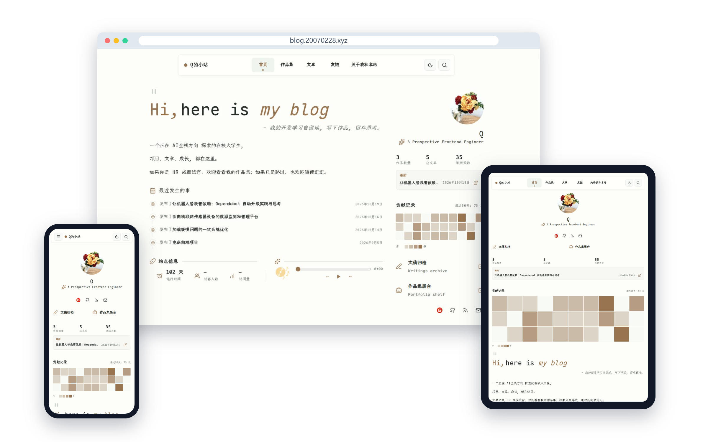

<p align="center">
   <strong style="font-size:24px;">My Personal Tech Blog</strong>
</p>

<p align="center">
This is my personal tech blog and portfolio, documenting my learning journey, project practices, technical notes and casual writings in AI full-stack development. This site focuses on real-world projects, development retrospectives and continuously accumulated practical content.
</p>

<p align="center">
  <a href="./README.md">简体中文</a>
  ·
  <a href="./README.en.md">English</a>
  ·
  <a href="https://blog.20070228.xyz/">Live Preview</a>
</p>

<p align="center">
  
</p>

## Content

- A personal homepage with recent writing, contribution activity, and site information
- Blog posts covering development notes and technical reviews
- Project pages with implementation details
- A friends page with a link application form
- An About page covering background, skills, and the site itself
- RSS, full-text search, Giscus comments, and responsive reading layouts

The current top navigation includes Home, Projects, Blog, Friends, and About.

The Vibe and Media modules remain in the codebase but are currently disabled. They can be enabled later if short-form notes or books, films, and music become part of the site.

## Stack

- Astro
- TypeScript
- Bun
- Tailwind CSS
- Markdown and MDX
- Pagefind
- Sharp
- Giscus
- Cloudflare Pages / Workers

## Local development

Requirements:

- Bun
- Node.js 22.12 or newer
- Python 3
- FontTools
- Brotli

Install dependencies:

```sh
bun install
```

Start the development server:

```sh
bun run dev
```

Run formatting and lint checks:

```sh
bun run format:check
```

Build the production site:

```sh
bun run build
```

Preview the production build:

```sh
bun run preview
```

The production build creates the CJK font subsets, static Astro pages, and the Pagefind search index.

## Content workflow

Key directories:

```text
src/config/site.toml       Site profile, navigation, theme, and homepage settings
src/content/about.mdx      About page
src/content/blog/          Blog posts
src/content/projects/      Project documents
public/images/             Avatars, icons, and static images
src/assets/figure/         Images used by project and article content
```

Create content with:

```sh
bun run post:new my-post
bun run post:new my-post --mdx
bun run project:new my-project
```

Images stored in `src/assets/figure/` can be referenced from Markdown or MDX with relative paths. Public assets use site-root paths beginning with `/`.

## Project structure

```text
src/
  components/              Homepage, blog, comments, and utility components
  config/site.toml         Site configuration
  content/                 Personal blog content
  layouts/                 Page layouts
  modules/routes/          Projects routes
  pages/                   Astro page entrypoints
  styles/                  Global styles
public/
  images/                  Static images and icons
  music/                   Homepage music assets
  videos/                  Project demo video
packages/                  Local Navfolio modules and plugins
scripts/                   Build, font, and content scripts
```

## Theme origin

This site is built on Astro and adapted from the Navfolio theme. The repository keeps the theme foundation while adding personal profile data, project content, Chinese font support, contribution heatmaps, site statistics, a music player, a friends page, and a customized homepage.

Original theme repository: [dodolalorc/astro-navfolio](https://github.com/dodolalorc/astro-navfolio)

## License

The original MIT License is retained. Site content, images, and personal information belong to the site author.
