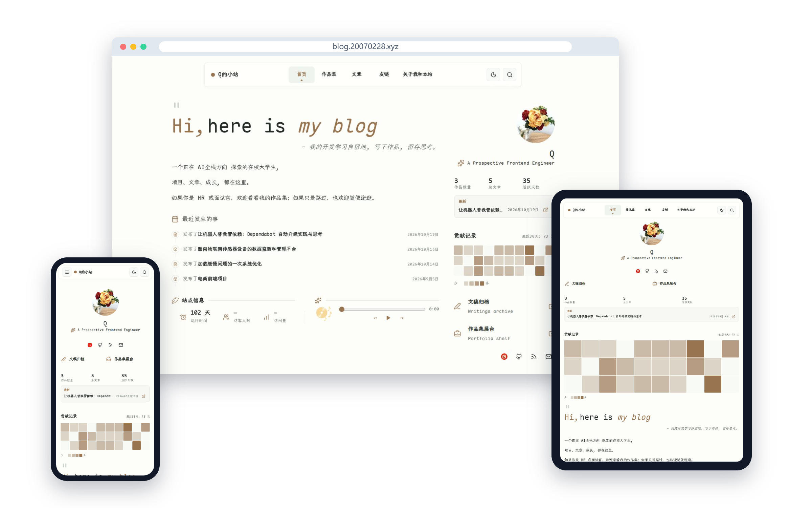

<p align="center">
   <strong style="font-size:24px;">我的个人技术博客</strong>
</p>

<p align="center">
这是我的的个人技术博客与作品集，记录 AI 全栈方向的学习过程、项目实践、技术笔记和生活随笔。站点重点展示真实项目、开发复盘和持续积累的实践内容。
</p>

<p align="center">
  <a href="./README.md">简体中文</a>
  ·
  <a href="./README.en.md">English</a>
  ·
  <a href="https://blog.20070228.xyz/">在线预览</a>
</p>

<p align="center">
  
</p>

## 内容

- 首页个人介绍、最近文章、贡献热力图和站点信息
- Blog 技术文章、开发记录与问题复盘
- Projects 项目作品和实现说明
- Friends 友链与申请入口
- About 个人经历、技能和本站介绍
- RSS、全文搜索、Giscus 评论和响应式阅读体验

当前顶部导航为：

`首页`、`作品集`、`文章`、`友链`、`关于我和本站`。

Vibe 与 Media 的代码仍保留在项目中，但当前没有启用。以后需要记录短内容或书影音时，可以重新打开对应模块。

## 技术栈

- Astro
- TypeScript
- Bun
- Tailwind CSS
- MDX 与 Markdown
- Pagefind
- Sharp
- Giscus
- Cloudflare Pages / Workers

## 本地开发

环境要求：

- Bun
- Node.js 22.12 或更高版本
- Python 3
- FontTools
- Brotli

安装依赖：

```sh
bun install
```

启动开发服务器：

```sh
bun run dev
```

执行格式和代码检查：

```sh
bun run format:check
```

生成生产构建：

```sh
bun run build
```

预览生产构建：

```sh
bun run preview
```

生产构建会生成中文字体子集、Astro 静态页面和 Pagefind 搜索索引。

## 内容维护

常用内容目录：

```text
src/config/site.toml       站点资料、导航、主题和首页配置
src/content/about.mdx      关于页面
src/content/blog/          博客文章
src/content/projects/      项目文档
public/images/             头像、图标和静态图片
src/assets/figure/         项目正文图片
```

创建内容：

```sh
bun run post:new my-post
bun run post:new my-post --mdx
bun run project:new my-project
```

文章和项目图片可以放在 `src/assets/figure/`，再从 Markdown 或 MDX 中使用相对路径引用。公共目录中的图片使用以 `/` 开头的站点路径。

## 项目结构

```text
src/
  components/              首页、博客、评论和工具组件
  config/site.toml         站点配置
  content/                 个人博客内容
  layouts/                 页面布局
  modules/routes/          Projects 页面路由
  pages/                   Astro 页面入口
  styles/                  全局样式
public/
  images/                  站点静态图片和图标
  music/                   首页音乐资源
  videos/                  项目演示视频
packages/                  Navfolio 本地模块和插件
scripts/                   构建、字体和内容脚本
```

## 关于主题来源

本站基于 Astro 和 Navfolio 主题改造而来，保留了主题的基础架构，并加入了个人资料、项目内容、中文字体、贡献热力图、站点统计、音乐播放器、友链页面和个人化首页布局。

原主题仓库：[dodolalorc/astro-navfolio](https://github.com/dodolalorc/astro-navfolio)

## 许可

项目继续保留原主题的 MIT License，同时本站内容、图片和个人资料属于本站作者。
