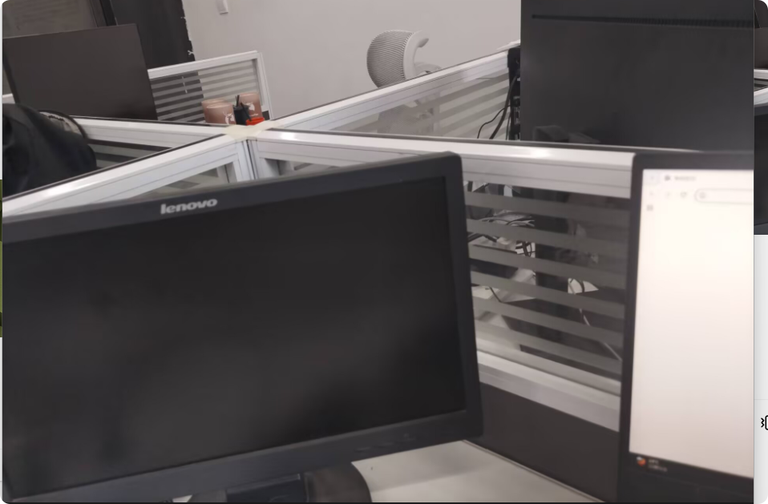
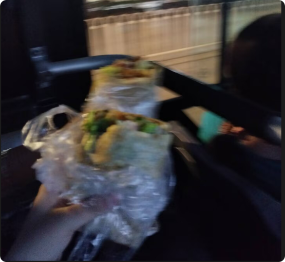

import ImageGallery from '../../components/ImageGallery.astro';

第一次线下实习，终究还是画上句号啦！

其实在这之前，大二的时候也有过一段实习经历，不过当时是远程实习实习、也就是线上办公。相比之下，这次算是我第一次真正走进公司，开始每天通勤上下班、和老板以及同事面对面交流。

从暑假开始，到开学后的快第二个月，前前后后将近四个月。这段线下实习时间说长不长，说短也不短，但确实收获不少，认识了一些很好的人，也留下了不少值得记住的事情（说的好像有点在写高中作文哈）。

## **关于工作：比想象中接触到的东西更多**

先说说工作吧。

其实当初投递的是前端实习生，原本以为日常工作应该会以前端页面开发这些内容为主。没想到真正参与工作业务之后，发现实际接触的东西和自己最初想象的还是有些不一样的。

这段时间的工作基本围绕着 Agent 开发、大模型应用、全栈开发这些展开，跨度对我来说还是比较大的。可能也是因为现在 AI 技术发展得太快了，整个团队的日常开发模式都和以前有些不一样。基本上每个人手里都有一个，甚至多个 AI 工具辅助开发。在一天需要处理好几个需求的情况下，借助 AI 完成开发、排查问题，似乎也已经成了一件很常见的事情。

不过很幸运的是，公司还是比较愿意培养实习生的。刚开始的时候，带我的学长也并没有直接让我上手项目，而是先安排了一些学习内容，让我有一周左右的时间熟悉和了解相关技术。之后才慢慢开始接触实际工作，遇到不懂的问题也可以随时请教。对于刚开始接触这些业务的我来说，能有这样的学习和适应时间，确实挺好的。

当然，实习期间也不是一直顺顺利利的。

之前在网上刷到一些关于实习生闯祸的段子，每次看到还觉得，自己应该不会犯这种低级错误吧？

结果……没想到还是轮到自己了。

虽然不是什么严重的问题，带我的同事也说没啥关系、没事，但自己心里还是挺不好意思的。毕竟别人花时间带你，自己却因为一时疏忽出了小差错增加一些新的工作内容，多少还是会有点过意不去。

也算是提前体验了一下职场新人的小插曲吧。

以后还是得更加仔细认真一些，提交之前多检查几遍，不能总想着应该没问题就直接交出去！

总的来说，这段实习确实让我接触到了不少原本不在自己预期范围内的东西，是一次很不错的经历了！

## **遇见了很好的人**

说到具体做了多少事情，我觉得这几个月里遇到的人也值得好好记录一下。

先说带我的前辈，也就是学长。

真的很感谢他这段时间的指导和一些帮助，老板人也蛮好说话的，整个团队工作氛围给我的感觉也很好。说到这个，同事还会经常带我们早点下班哈（不过老板也是支持的，事情做完了当然是要早点回去美美休息的啦）

日常工作节奏比我想象得轻松得多的多，没有想象中那么紧张。不过嘛，我觉得这次自己工作过程当中的人情世故方面还是需要改善一下。

比如，每次在公司碰到老板或者同事，明明心里面打算的是主动打个招呼，但真到了面对面的那一刻，又会莫名其妙地不好意思。

脑子里想的是：要不要说声早上好？要不要主动打个招呼？

然后……就这样面无表情地走过去了。

现在回想起来，感觉还挺好笑的。明明只是一句很简单的问候，却总是需要在心里纠结半天。

**下次一定！下次再遇到熟悉的同事，直接大大方方地说一声 Hello！一定一定不会再犹豫了！**

职场中的这些小细节，大概也是需要慢慢适应和学习的吧。

## **还有，那趟一起上下班的 19 路公交车**

很幸运，这次实习还有一位搭子陪我一起上下班。

是实验室的朋友，一开始其实没有那么熟悉，平时因为不是一个专业的、所以也没有特别多的交集。后来因为一起去公司实习，每天上下班逐渐有了更多交流，四个月下来，也慢慢熟络起来了。

对方人真的很好。平时我经常会问一些自己不太熟悉的技术问题，她基本上是知无不言的感觉。还会主动跟我分享一些自己觉得很厉害、很有意思的根据、技术和知识这种，每次看完都有一种：哇，我也要这样，这个我也要学习！的感觉。

而且感觉她真的是一个很努力的人。恰好我又是那种很容易被身边人的坚持和努力所影响的人，看到别人一直在认真学习、不断进步，自己也会跟着受到激励，然后老老实实地继续学习。虽然偶尔还是免不了摸一点鱼。

所以，每天上下班的19路公交我们俩就这样一起等、一起坐车、一起回去（当然免不了起床晚了，一路飞奔赶车），路上也会聊聊当天的工作，或者一些其他乱七八糟的话题。

除了上下班，我们还一起探索了不少美食。实习那条路上真的有好多好吃的店，尤其有一家家常菜，真的超级好吃！感觉我们俩连着吃一个多月了。

希望以后还有机会一起上下班、一起讨论技术，继续分享一些有的没的！

## **关于离开：有些决定，确实需要考虑很久**

其实提出离职这件事，我也考虑了挺长时间。

最开始是在暑假期间实习，那时候时间相对充裕，正常上下班也没有太大问题。还记得第一次拿到工资条的时候，真的蛮激动的，毕竟是自己实习赚到的第一份工资嘛！

后来开学了，老板也考虑到我们还是学生，觉得应该以学业为主，所以主动提出可以调整实习时间，改成周末加上平时有空的时候过去。因为公司离学校也比较近，我们当时就决定继续留下来实习。

不过，真正开始这样安排之后，才发现时间还是有点不够用。

平时除了上课，其他空闲时间基本也都安排给了实习，留给自己学习、做项目以及休息的时间就少了很多。再加上来回通勤也需要花费一些时间，长期这样下来，确实有点忙不过来了。

所以，考虑了好一阵子之后，还是决定让这段线下实习先告一段落啦！

希望公司、老板和同事们都工作顺利，大家一起蒸蒸日上！

## **下一站：好实习快来找我！**

这次线下实习结束了，但学习和尝试当然不会就此停止。

接下来打算继续学习新的技术栈，多做一些项目，争取让自己的技术能力再往前走一走。同时，打算找一份线上实习。

其实我更想寒假去线下实习的。不过我寒假只有一个多月，不知道有没有公司愿意接收一个只能实习一个多月的？如果时间和机会都合适的话，大学期间还是更想线下实习的。

**最后，谢谢这段时间遇到的每一位善意的人，也谢谢那个虽然有点社恐、偶尔会不好意思打招呼，但还是一直在努力学习和尝试的自己。**

第一次线下实习，圆满结束啦！下一段旅程也要开始准备啦！

**希望下一份实习也能遇到很好的人，学到更多东西，不断进步。**

好实习快来找我！！！

<ImageGallery>
  

  
</ImageGallery>

