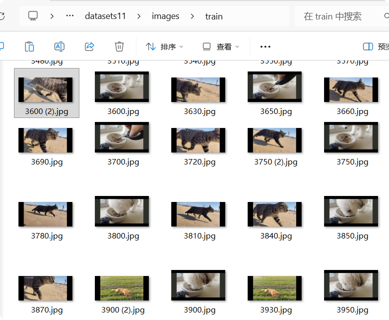
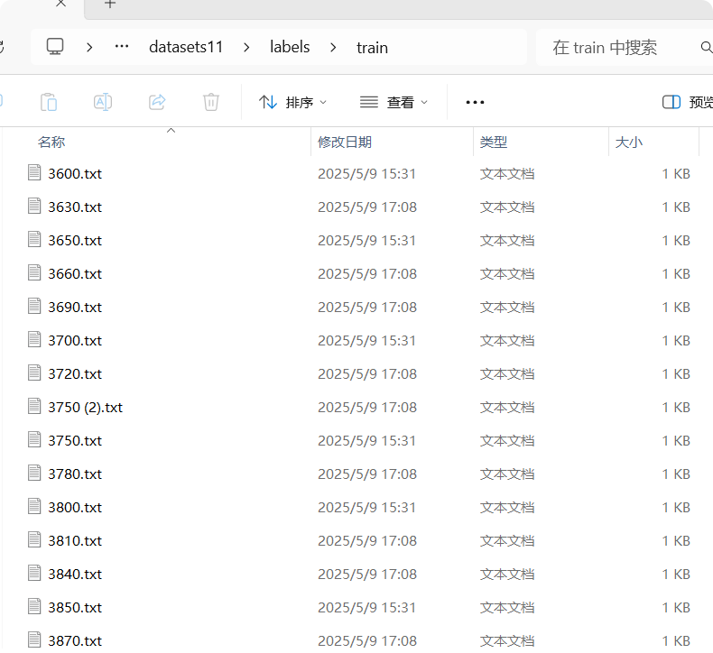
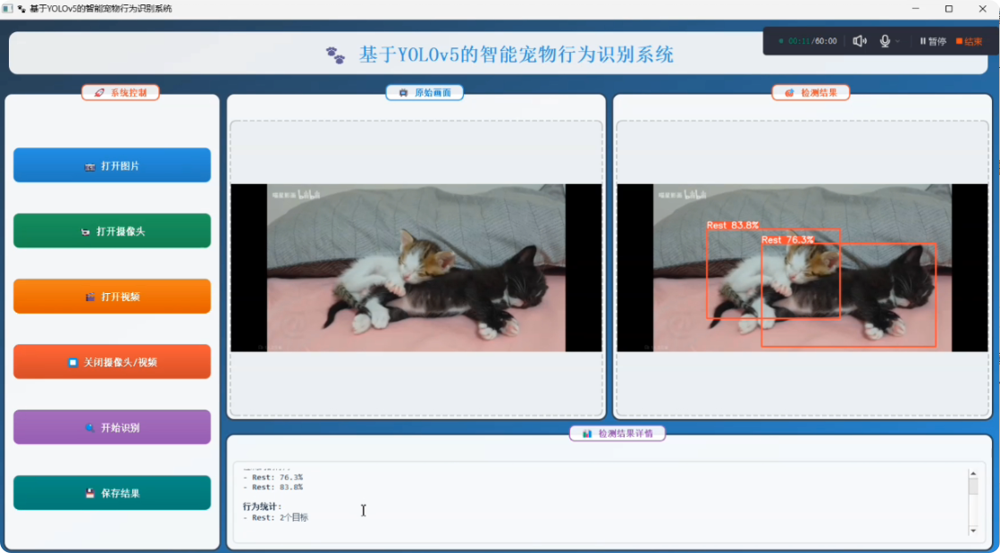

宠物行为识别系统（IPBRS）是一个 Windows 平台下的桌面端 AI 应用。项目先为宠物的行为设计了 4 大类 6 子类“**活跃（Active）、进食（Eating）、异常（Abnormal-vomiting）[包括呕吐（Abnormal-vomiting）、异常破坏（Abnormal-destructive）]、休息（Rest）**”。
随后按这套分类收集宠物行为视频、逐帧抽取出图片来构建数据集并完成标注，用 YOLOv5 训练出检测模型，最后基于 PyQt5 开发
桌面端程序把模型部署进去，支持图片、摄像头实时流、本地视频文件三种输入源，完成了从模型训练到桌面端运行的功能开发。

项目运行效果如下：
<video controls width="100%" preload="metadata" playsinline>
  <source src="/videos/pet-behavior.mp4" type="video/mp4" />
  您的浏览器不支持视频播放。
</video>

## 技术栈

- Python + PyCharm（开发语言与 IDE）
- PyQt5（桌面端 GUI 框架）
- YOLOv5 + PyTorch（目标检测模型与训练）
- OpenCV（图像/视频读取与处理）
- LabelImg（数据集标注工具）
- SQLite（识别结果与操作日志持久化）

## 核心功能模块

### 数据集收集与标注

项目先准备给模型"喂数据"，按之前定好的分类体系，在网络上面搜集宠物日常行为的视频素材，再用 OpenCV 按固定间隔抽帧取出图片来构建数据
集，再对图片进行LabelImg 逐张标注出宠物目标框和行为类别，导出 YOLO 格式的 txt 标签文件。最后按照 YOLOv5 要求的目录结构组织数据
集：images/train、images/val 放图片，labels/train、labels/val 放对应标签，一一配对。
说起来标注真的是一个很枯燥的环节，一张张点框点类别，标注到后面眼睛都花了，不过也因此实打实地学会了 LabelImg 的一些标注规范
、也理解了检测模型的上限，很大程度在数据集质量上就决定了——标注框不准、样本太单一，后面训练调再多参数也救不回来。

### YOLOv5 模型训练

数据集准备好后，我在 **YOLOv5 官方工程**里新建了配置文件 `data/bvn.yaml`，指定数据集根目录、train/val 划分路径和类别 names，然后用 `yolov5s` 作为基网络跑 `train.py` 开始训练。

训练不是一次成功的，前后跑了**挺多轮实验**（`runs/train/exp` 一直堆到了 exp65），反复对比后挑出效果最稳定的一轮，把 `runs/train/exp65/weights/best.pt` 留作最终部署权重。
这段"炼丹"搬的经历让我对模型训练相关的这些专业词汇有了实感。

### PyQt5 桌面端部署：模型接入与三种输入源

训练完的 best.pt 只是个权重文件，为了让它变成"能用的软件"，本项目采用 PyQt5 写一个桌面程序把它包起来。
界面搭好后，就是把模型接进来。源程序通过 sys.path 引入 YOLOv5 工程路径，复用官方的 DetectMultiBackend 封装加载 best.pt，启动时自动完成设备选择、模型预热（warmup），为实时推理做准备。

界面上提供三种输入源，对应不同使用场景：

- **打开图片**：支持 png/jpg/jpeg/bmp/tif 格式，加载后在原始画面区显示；
- **打开摄像头**：调用本地摄像头，1280×720@30fps 实时采集画面；
- **打开视频**：兼容 mp4/avi/mov/mkv/flv 主流格式，选中后自动播放。

## 后续可以扩展什么

- **接入公开数据集提升准确率**：当时训练主要靠自己收集标注的小规模数据，样本量和场景覆盖都有限；后续可以接入公开的宠物行为数据集扩充样本，结合迁移学习提升模型的泛化性和识别准确率
- 引入**目标跟踪**（如 BoT-SORT），实现跨帧的宠物个体跟踪与行为时序统计

## 一点感想

　　　这个项目是我大一就开始上手的，准确来说，算是我第一个跟本专业相关的开发项目。如果要谈谈“为什么要做这个？”的话，就得说到当时在老师带领下参加的挑战杯比赛了，因为这个项目就是为比赛而做的。我作为项目负责人，主要和朋友一起完成，期间老师和学长也给我们提供了很大的帮助。

　　　从一开始下载软件、配置环境，到收集宠物行为视频素材、抽帧构建数据集、用 LabelImg 标注、跑 train.py 训练模型——模型第一次跑通的那一刻觉得挺有成就感的。再往后又结合 Qt，把训练导出的 best.pt 直接加载进界面里，做成一个能点按钮、能开摄像头实时识别的完整应用——源程序里的 YOLOv5Detector 就是加载 best.pt 做推理的部分，到这一步，界面和模型才算是真正连在了一起。

　　　严格来说，Qt 这块我当时完全没系统学过，相关代码主要靠在知乎上看大佬们写的开源分享，翻了好多篇，具体参考了哪几篇时间久了是真记不清了，反正就是边看边学边改。更早的时候，我连"模型可以用显卡跑"都不知道，推理一直拿 CPU 硬扛，后来还是一位学长帮忙切到了 GPU，速度简直立竿见影，我才意识到我的知识储备是远远不够的。不过好在最后总算弄出来了点结果。

　　　总的来说，这个项目让我搞明白了两件事：一是模型从数据收集、标注、训练到部署运行到底是怎么跑起来的；二是怎么用 Qt开发。比较可惜的是，后来我的学习重心慢慢转到了前端网页和小程序上，Qt 桌面开发和模型训练这些知识都有点模糊了。把这篇项目记录放在本站里，就当是给自己留个存档，希望以后能把这些东西回头捡一捡，有机会再接触这类项目。
