import ImageGallery from '../../components/ImageGallery.astro';

该项目不是只针对某台设备做的演示页面，而是尽量做成一套可以复用的平台底座：设备通过 MQTT 上报数据，后端完成校验、入库和异常判断，再通过 HTTP 接口和 WebSocket 把数据提供给客户端；用户在 Web 或 微信小程序 上查看实时工况、查询历史数据、配置指令，操作再沿反方向下发回设备。

项目默认对接的是一套水循环系统，包含水槽、水管回路、水泵、压力传感器、流量传感器和加热模块。具体有哪些传感器、字段叫什么、单位是什么，并没有写死在前端页面里，而是由数据库中的字段映射表决定。换一个应用场景时，主要改映射表和配置表，大部分前后端代码都可以继续复用。

另外要说明的是，这个项目与“硬件和通信方向”的同学进行了合作，我主要个人独立负责平台应用层侧的后端、Web 端和 App 端的开发，实际投入应用的时候“MQTT 的主题和字段”需要按照通信那边使用的协议来接入，具体可以直接在backend/sc/mqtt/client.js修改配置。

项目仓库地址：<a href="https://gitee.com/qu-fangxiang/sensor-project" target="_blank" rel="noopener noreferrer">sensor-project（Web 端 + 后端）</a>

项目在线访问地址（Web端页面暂未做响应式适配，在手机、平板等窄屏设备上会出现排版错乱，请使用电脑浏览器访问）：<a href="http://8.148.78.43/sensor/realTimeData" target="_blank" rel="noopener noreferrer">sensor-project</a>


```text
Web（Vue 3 + Element Plus） ─┐
                              ├─ HTTP + WebSocket ─ Express ─ MySQL
App（uni-app + uView Plus） ─┘         │
                                       └─ MQTT ─ 设备 / 通信模块
```

## 技术栈

- Web：Vue 3 + Vite + Element Plus + Pinia + Vue Router
- Web 图表：ECharts
- App：uni-app（Vue 3）+ uView Plus + Pinia
- App 图表：qiun-data-charts（uCharts）
- 端侧请求：Axios（Web）、uni.request（App）
- 实时通道：浏览器 WebSocket（Web）、uni.connectSocket（App）
- 后端：Express + mysql + MQTT.js + ws + dotenv
- 数据与通信：MySQL 8、MQTT Broker（EMQX / Mosquitto）、Modbus RTU 报文
- 运行环境：Node.js 20.19+ / 22.12+

## 核心功能模块

### **双端形态：Web 看板 + uni-app 小程序端**

这个项目做了两个客户端：一个是 Vue 3 的 Web 端，另一个是 uni-app 的 小程序端。两端共用同一个 Express 后端、同一套 MySQL 数据和同一条 MQTT 接入链路，区别主要在交互形态和端侧适配。

小程序端目前的运行效果如下，这里只展示其中几个页面：

<ImageGallery>
  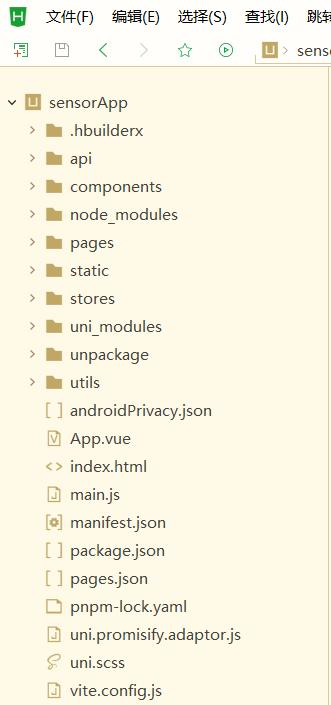
  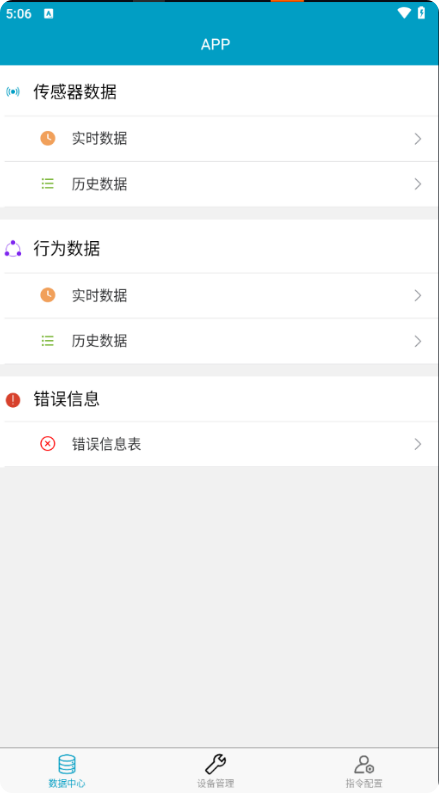
  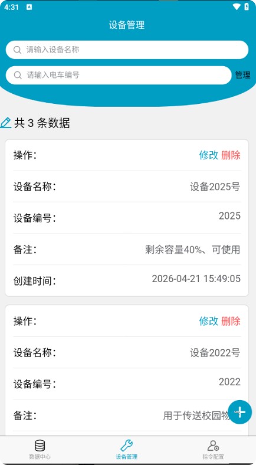
</ImageGallery>

Web 端的运行效果建议直接访问上面的<a href="http://8.148.78.43/sensor/realTimeData" target="_blank" rel="noopener noreferrer">项目在线链接</a>查看，此处不再重复演示。需要再次说明的是，Web 端目前没有做响应式适配，在手机、平板等窄屏设备上打开会出现排版错乱，建议使用电脑浏览器访问。

另外，小程序端当时没有打包上线，只停留在开发调试和跨端验证阶段，后续也没有继续维护，因此下文主要以 Web 端为主线展开说明。

### **和通信/硬件联调：真实的 MQTT 主题与字段**

设备端按约定往固定主题发 JSON，平台应用层按字段解析；平台下发指令时，也按设备能识别的 Modbus 报文格式拼。像这些相关的MQTT 协议需要与负责底层设备的人一起约定。

| 主题 | 方向 | 用途 | 关键字段 |
| --- | --- | --- | --- |
| `heart` | 双向 | 设备心跳 / 在线询问 | `deviceId` |
| `offline` | 设备 → 平台 | 传感器数据上报 | `id`、`time`、`temp_out`、`temp_in`、`pressure`、`flow_rate`、`heat_Y1`、`water_Y2` |
| `bHData` | 双向 | 行为数据上报和储存 | 按 `t_behavior_field_mapper` 映射 |
| `error` | 双向 | 异常信息上报和储存 | `e_no`、`e_msg`、`type`、`source` |
| `sends` | 双向 | 自动控制指令和储存 | `mb`、`sn`、`ack`、`crc`、`uart` |

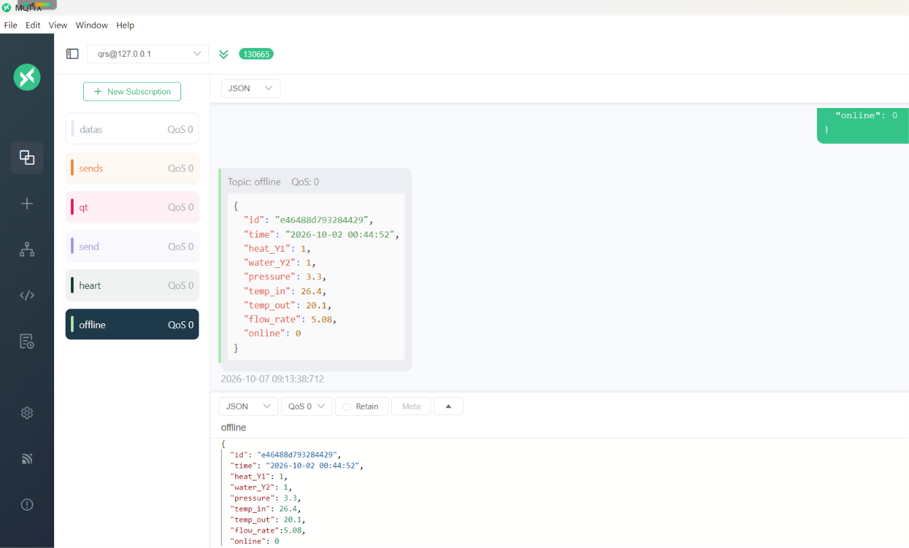

几个容易混淆的点：

- `offline` 这个主题名看起来像“离线通知”，实际承载的是上报的传感器数据，并通过该主题中的"online"字段来区分在线/离线数据，方便数据储存显示
- `bHData` 是行为数据。可以是底层设备上传的行为数据；也可以直接接智能判定相关接口：前端可以把选中的数据提交到 /api/sensor/recognize，后端把结果写入行为数据表。目前这部分实际运用的时候需要接入外部可用的智能判定相关API 时，主要改 adaptResponse 这一层。
- 本项目适配了中间判断层，即设计判断规则，"error"等主题的逻辑可以通过上报的传感器数据直接进行判断、控制这种，由平台下发给设备。需要增加或者修改错误判断规则，可以修改：backend\sc\service\dataValidateService.js代码

传感器上报的消息长这样：

```json
{
  "id": "e46488d793284429",
  "time": "2026-09-07 18:29:40",
  "heat_Y1": 1,
  "water_Y2": 1,
  "pressure": 2.3,
  "temp_in": 26.4,
  "temp_out": 26.1,
  "flow_rate": 7.08,
  "online": 0
}
```
- 传感器数据里的 `id` 是设备编号，不是数据库自增主键；
- `heat_Y1`、`water_Y2` 是加热和水泵的开关状态，`1/0` 入库时会转成“打开/关闭”；
- `temp_out` 是加热出口温度，`temp_in` 是进水储水槽温度，PID算法控制的就是 `temp_out`；`pressure` 是压力，`flow_rate` 是瞬时流量。

平台下发的指令统一是 `mb/sn/ack/crc/uart` 这组字段，其中 `mb` 是 Modbus 报文。以加热器开、水泵开为例，`mb` 的拼法是 `0106` + `000` + `preffix` + `000` + `onOff`：加热器 `preffix=0`、开=1，得到 `010600000001`；水泵 `preffix=1`、开=1，得到 `010600010001`。`preffix` 来自 `t_direct_config` 表，表里字段名就是 `preffix`，不是 `prefix`。其余 `sn/ack/crc/uart` 在当前协议里是固定值：`sn=1`、`ack=1`、`crc=1`、`uart=0`。

```json
{
  "mb": "010600000001",
  "sn": 1,
  "ack": 1,
  "crc": 1,
  "uart": 0
}
```

数据库设计：字段映射表 `t_sensor_field_mapper` / `t_behavior_field_mapper` 负责把协议字段翻译成业务字段：`p_name` 是设备上报的字段名（如 `temp_out`），`db_name` 是数据库里的通用列（如 `field1`），`f_name` 是前端显示名（如“加热温度”），另外还有 `unit`、`visible`、`type` 等配置。这样数据库里存的是 `field1`、`field5` 这类通用列，前端看到的却是“加热温度”“瞬时流量”，换场景时改映射表就行。

### **数据接入、校验与实时监测**

后端启动时就连 MQTT Broker，订阅 `heart`、`offline`、`bHData`、`error`、`sends`、`direct`。收到消息后先排除 `retmb` 这类 Modbus 回显报文，再按主题分流：传感器数据先过校验，再入库并推送；行为数据直接入库；异常信息写入 `t_error_msg` 并推送。

设备在线状态是按 `offline` 主题的到达时间判断的：3 秒内收到数据就算在线，超过 3 秒就标记离线；后端每秒把设备状态通过 WebSocket 推给前端。设备离线时下发的指令不会丢，会先缓存在后端，等设备重新上线再补发。

WebSocket 按数据类型分频道，前端按需订阅：`sensorData`、`behaviorData`、`errorData`、`directData`、`directHistoryData`、`deviceStatus`。实时页用卡片显示最新值，用 ECharts 画曲线；Web 端异常信息用黄色提示框弹出，保留 10 秒，同时写进异常页面。


<ImageGallery>
  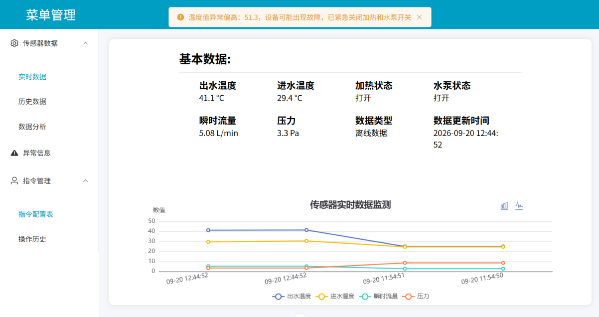
  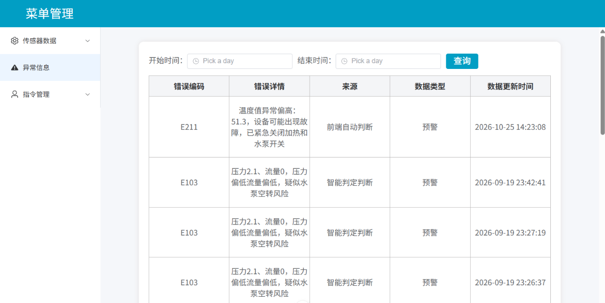
  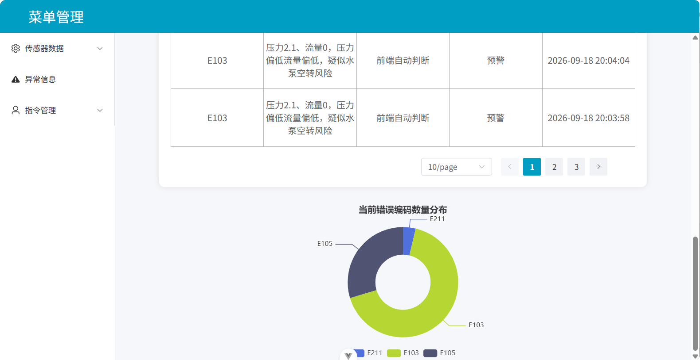
</ImageGallery>

### **Web 端的历史查询与数据分析**

历史数据支持按时间范围、设备编号等条件组合筛选，并做了分页。数据分析页在后端有一套比较通用的查询方法：支持 `start_time`、`end_time`、`limit`、`order`、`groupBy`、`aggregates`、`fields`、`where` 这些参数，按小时/天/周分组时用 `DATE_FORMAT` 生成时间桶，聚合函数支持 `AVG`、`SUM`、`COUNT`、`MAX`、`MIN`。

累计流量用梯形积分：相邻两个采样点的流量平均值乘以时间差，再逐段累加。水泵和加热的运行时长按采样点中“打开”的条数换算成分钟，平均温度和总流量也在页面顶部汇总。数据量大时用 `step` 参数按时间桶降采样，避免一次把太多点塞进图表。

<ImageGallery>
  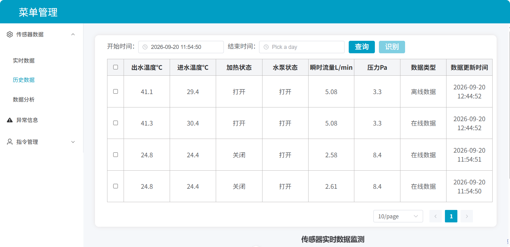
  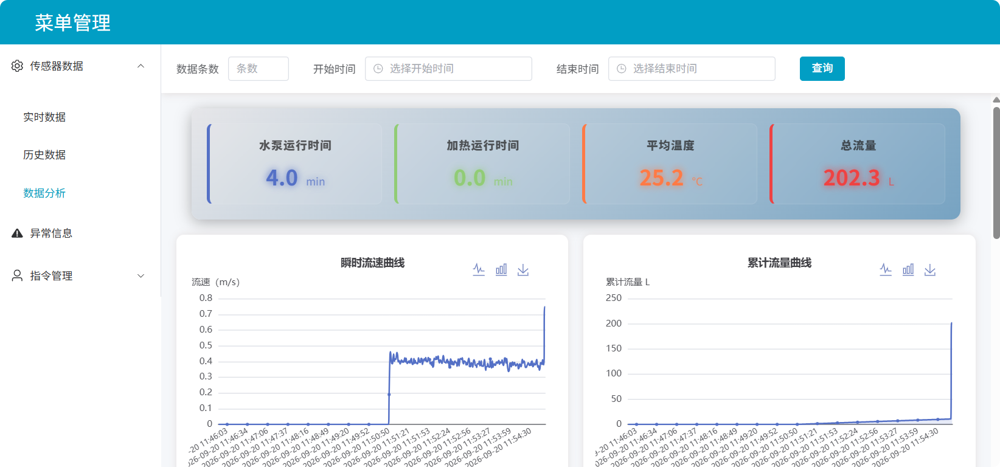
</ImageGallery>

### **指令配置、定时控制与 PID 恒温**

指令配置以树形结构渲染 `t_direct_config`表，字段包括 `id`、`ref_id`、`ref_value`、`t_name`、`f_type`、`f_value`、`min`、`max`、`order`、`icon`、`mode`、`preffix`、`topic`。`f_type` 对应开关按钮、输入框、滑动按钮、时间框和单选框，前端递归渲染；`ref_id` / `ref_value` 控制父子项联动，比如某个模式打开后才显示下面的参数。

用户改完配置后，后端更新 `t_direct` 的实时值，把操作写入 `t_direct_data`，再按 `topic` 找到目标主题，把 `mb/sn/ack/crc/uart` 指令发出去。手动指令的目标主题不是写死的，而是从 `t_direct_config.topic` 查出来的；当前配置下对应 `direct`。操作历史会记录 `config_id`、`direct_name`、`d_no`、`value`、`old_value`、`status`、`source`、`c_time`，其中 `source` 会区分底层设备、前端手动控制、AI 判定结果和前端自动控制。

自动控制模式下，会有相关的指令控制功能，比如：定时开关一旦打开，就会每秒检查一次当前时间是否落在 `t_direct_config` 配置的起止时间内，到点自动开/关水泵和加热器；恒温控制模式打开下用 PID 做恒温：从 `t_direct` 读取目标温度、`Kp`、`Ki`、`Kd` 和控制周期，算出 0~100% 的占空比，再按 PWM 的思路在一个周期内控制加热器开启时长。积分项做了限幅，避免积分饱和，只有状态真正变化时才下发指令。

<ImageGallery>
  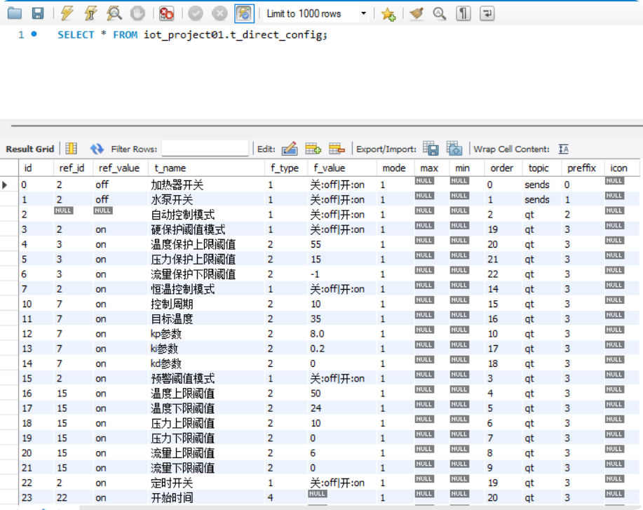
  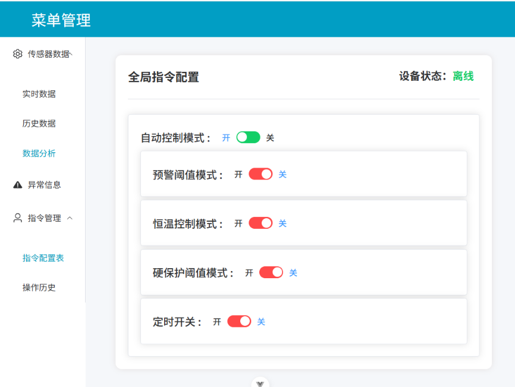
</ImageGallery>

### 单/多设备与场景适配

项目通过统一的 `IS_MULTIDEVICE` 开关切换单设备和多设备模式。单设备模式下只展示全局配置，设备管理菜单隐藏；多设备模式下开放设备管理、按设备编号筛选和按设备维度下发指令。设备信息存在 `t_device` 表，字段包括 `device_name`、`number`、`remarks`、`ctime`，支持新增、修改、删除和按名称/编号查询。

平台的“通用”主要靠映射表和配置表：传感器字段由 `t_sensor_field_mapper` 决定，行为字段由 `t_behavior_field_mapper` 决定，指令和阈值由 `t_direct_config` 决定。当前数据库匹配的是水循环系统，换一套设备时优先改这些表，而不是在前端页面里到处改字段名。

## 一点感想

刚开始写这个项目的时候，给我的感觉就是还行还好（现在回过头来看感觉自己有时候也蛮自信的），后面等真正一步步做下来才发现存在许多让人头疼的问题。双端的开发让我踩了不少 uni-app 的坑；等页面大致写完之后，发现难点其实也不在页面本身，而在设备、数据和指令之间那条链路。后端怎么设计才尽可能一套能跑通、改起来不崩——接口怎么划分、数据怎么取出来才能同时支持实时查看、历史分页、聚合分析这几种查询方式、字段映射怎么和数据库的通用列对上；前端这边，树形指令配置从接口传过来之后，父子项怎么联动、递归渲染怎么和指令下发的逻辑对上，这些都是需要深思熟虑的。

同时这个项目也让我体会到模块化、集中化管理配置与业务规则的价值。我把异常判定规则单独抽离成模块维护，传感器字段采用映射表统一管理，指令 ID、阈值等常量全部收拢放在 config/ 目录下。代码结构按功能模块拆分，可读性更强；后续迭代功能、切换传感器业务场景时，只需要修改对应配置，不用在业务代码里零散查找硬编码，维护成本低，也不容易改出问题。

2026年，我还拿着这个项目与“俩位负责底层设备的同学”一起参加了第十届湖南省大学生物联网应用创新设计技能赛，最终结果还挺不错——美美拿了个一等奖（14/101）。这个过程中，尤其是实际联调的时候，关于“MQTT 主题怎么划分、字段怎么对齐、设备离线时指令怎么缓存、上线后怎么补发、异常发生后先关哪个设备、PID 参数怎么调”——这些问题是没有现成答案，只能一边联调一边改，在反复联调中迭代完善。


