import ImageGallery from '../../components/ImageGallery.astro';

Shopping Mall 是一个面向移动端的电商项目，个人独立开发完成了电商核心链路的前端开发：首页商品展示与分类浏览、用户登录与鉴权、商品搜索与详情、购物车增删改查、订单结算等模块。

在线访问地址：<a href="https://mall.20070228.xyz/preview" target="_blank" rel="noopener noreferrer">shopping-mall</a>

项目仓库地址：[gitee.com/qu-fangxiang/shopping-mall](https://gitee.com/qu-fangxiang/shopping-mall)

## 为什么做这个项目

　　　2025 年初学 **Vue框架** 的时候，我总觉得光看视频、敲几个示例代码没啥用——当时看懂了，过两天就忘得差不多，更别提实际项目里会碰到的那些错误和困难，光靠看根本体会不到。就像看菜谱学做菜，不动手很难知道自己会倒在哪一步。于是我依旧是激情满满地去B站上找一个项目：从头到尾亲手敲一遍，跟着做一个完整的电商前端项目练练手！

　　　至于为啥选电商项目呢？一是因为以后实际工作里，小程序、App 这类电商项目肯定很常见；二是因为它"啥都有"——**列表渲染、路由跳转、状态管理、登录鉴权、购物车增删改查**...基本上 Vue 2 该练的技能点，它全给包圆了。

　　　说实话，那时候还不像后来这样依赖 AI、简直快成了一个"yes"工程师了。当时一个个手敲代码，确实挺花时间，过程中也踩了不少坑，但也正是在这个过程中学到了蛮多东西：比如用 **Axios 统一实例封装请求、按业务模块拆分接口文件；通过公共组件抽取和 Less 变量统一主题；引入 Vant 2 组件库，包括阿里云图标库来方便开发；熟悉 npm/yarn/pnpm 包管理器；上手 Vuex/Pinia 状态管理乃至 localStorage 本地持久化；用 PostCSS + px-to-viewport 做移动端 vw 适配；用 ESLint 做代码检查**等等一系列的开发实践流程。这些现在回头看都挺值的——毕竟纸上得来终觉浅，代码跑通运行了才是真懂了。

　　　最后，需要说明的是该项目后端接口用的是B站黑马程序员提供的课程接口文档。当时开发的时候就是跟着黑马教程做的，毕竟这个项目主要还是用来学习并巩固技术栈的。个人觉得鹏鹏老师的讲解非常详尽，该系列教程后续还涵盖了 Vue 3 大事件管理系统的实战。如果你正在学习/想学习 Vue，或者想了解移动端电商项目长啥样、开发流程是怎样的，欢迎翻翻[我的项目仓库](https://gitee.com/qu-fangxiang/shopping-mall)以及[黑马程序员 Vue2+Vue3 前端教程](https://www.bilibili.com/video/BV1HV4y1a7n4)看看。

## 技术栈

- Vue 2 + Vue CLI （核心框架与脚手架）
- HTML + JavaScript + Less（页面结构、逻辑与样式预处理）
- PostCSS + px-to-viewport（移动端适配）
- Vue Router 3（路由管理）
- Vuex 3（状态管理）
- Vant 2（移动端 UI 组件库）
- Axios（HTTP 请求）
- ESLint（代码检查）

## 核心功能模块

### 首页商品展示、商品详情页面、分类浏览与搜索

首页的数据来自一个**聚合接口** `getHomeData()`。后端把轮播图、宫格导航、推荐商品拆成不同「楼层」放在同一个响应里返回，前端**只需要请求一次**，把对应楼层的数据分别赋值给 `bannerList`、`navList`、`proList`，模板中通过 `v-for` 渲染：`van-swipe` 渲染轮播图，`van-grid` 渲染宫格导航，`GoodsItem` 复用商品卡片渲染推荐列表,减少首屏的接口调用次数。组件在 `created` 中发起请求，再。页面完全由**数据驱动**，后端调整楼层内容时，前端不需要修改渲染逻辑。

分类页采用**左侧一级分类 + 右侧二级分类**布局。页面初始化时只调用一次 `getCategoryData()`，把完整分类树取回本地；左侧点击时只修改 `activeIndex`，右侧直接读取已缓存的 `list[activeIndex].children`，**不会因为切换分类而重复请求接口**。右侧使用**可选链** `?.children`，避免数据还没返回时访问空值报错。

搜索入口页的关键词历史直接读写 `utils/storage.js` 的 `getHistory / setHistory`，**不经过后端接口**。搜索时先**去重再 `unshift` 置顶**，保证同一个关键词只出现一次，并且最近搜索排在最前；清空历史时**同时更新内存状态和 localStorage**，避免刷新后历史重新出现。搜索结果页与分类页**共用同一个列表页**：搜索入口传 `search`，分类入口传 `categoryId`，接口参数都是可选的，前端按实际参数调用 `getProList`，从而复用同一套渲染逻辑。

顶部导航栏和搜索框都使用 **`fixed` 定位**，页面容器统一加 **`padding-top: 100px`**，避免内容被固定头部遮挡。搜索框本身不输入，只作为入口，用 **`readonly` 禁用键盘**并绑定 `@click` 跳转搜索页，交互与原生搜索框一致。

详情页使用**动态路由** `/prodetail/:id`，组件内通过 `this.$route.params.id` 获取商品 ID，并在 `created` 中**同时请求详情和评论**。两个请求互不依赖，**并发发出**可以缩短页面等待时间；评论接口通过 `limit` **只取前几条**用于首屏展示，减少不必要的数据传输。

<ImageGallery>
  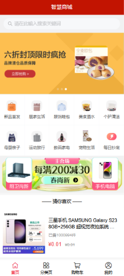

  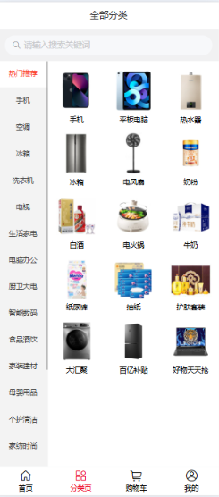

  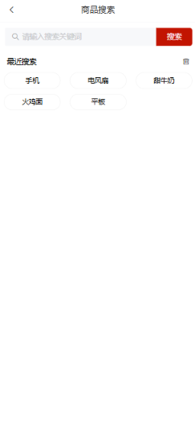

  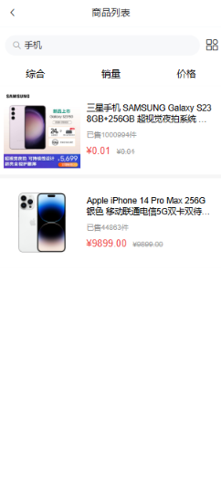

  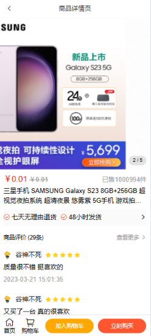
</ImageGallery>

### 用户登录与 token 鉴权

登录页采用「手机号 + 图形验证码 + 短信验证码」流程：前端在发送请求前用**正则校验**手机号和验证码格式，减少无效请求。短信按钮带60 秒倒计时，通过定时器标记和秒数判断避免重复点击。

鉴权分为**两层**：

- **页面级**：`router/index.js` 维护 `authUrls = ['/pay', '/myorder']`，**全局前置守卫**检查 token，未登录时跳转登录页。部分页面需要登录后才能进入，就会在这一层被拦截。
- **接口级**：`utils/request.js` 的**请求拦截器**从 Vuex 读取 token，写入 **`Access-Token` 请求头**，需要授权的接口无需在每个页面手动携带 token。

<ImageGallery>
  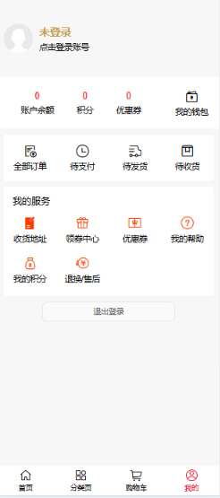

  

  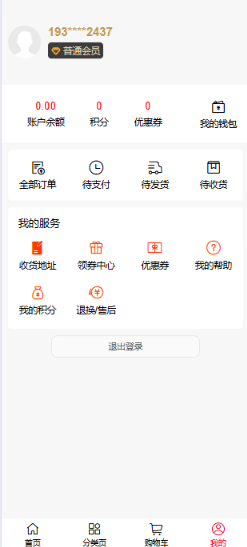
</ImageGallery>

### 购物车增删改查

购物车是状态联动最多的页面，数据统一放在 **Vuex 的 `cart` 模块**：

- `state.cartList` 保存购物车列表
- `getters` 派生 `cartTotal`、`selCartList`、`selCount`、`selPrice`、`isAllChecked`
- `mutations` 负责 `setCartList`、`toggleCheck`、`toggleAllCheck`、`changeCount`
- `actions` 负责 `getCartAction`、`changeCountAction`、`delSelect`

后端返回的购物车数据**不包含勾选状态**，拉取列表时前端给每条商品**补充 `isChecked` 字段**，由 Vuex 统一维护。数量修改采用**本地优先更新**：`changeCountAction` 先 `commit` 修改本地数量，再请求后端同步。这样点击加减号时**界面立即响应**，不需要等接口返回，交互更流畅。

<ImageGallery>
  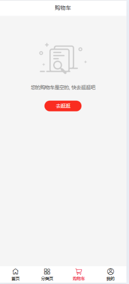

  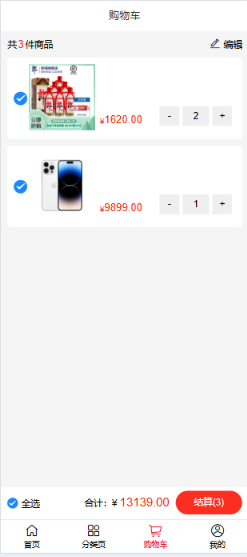
</ImageGallery>

### 我的订单与订单结算页面

结算页 `views/pay/index.vue` **同时支持两种来源**：购物车结算传 `mode=cart` 和 `cartIds`；立即购买传 `mode=buyNow` 以及 `goodsId / goodsSkuId / goodsNum`。进入页面后根据 `mode` 调用 `checkOrder` 获取**订单明细和账户余额**，提交时调用 `submitOrder`。页面通过 `mixins: [loginConfirm]` **复用登录确认逻辑**。

我的订单页 `views/myorder/index.vue` 使用 `van-tabs组件` 按「全部 / 待支付 / 待发货 / 待收货 / 待评价」切换，使用`watch` 监听 `active` 并设置 **`immediate: true`**，首次进入和切换 Tab 都会重新请求列表。同一个结算页用 `mode` 区分业务来源，避免维护两个几乎相同的页面。

<ImageGallery>
  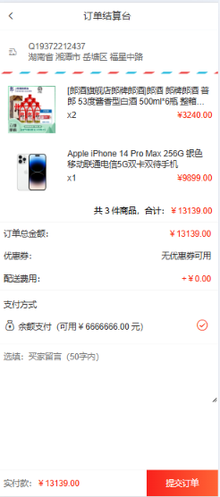

  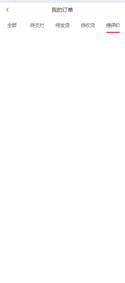
</ImageGallery>

## 后续可以扩展什么

- 接入**真实后端**替换课程接口
- 迁移到 **Vue 3 + Vite**
- 增加商品收藏、优惠券、**收货地址管理**、**真实支付**等电商功能

